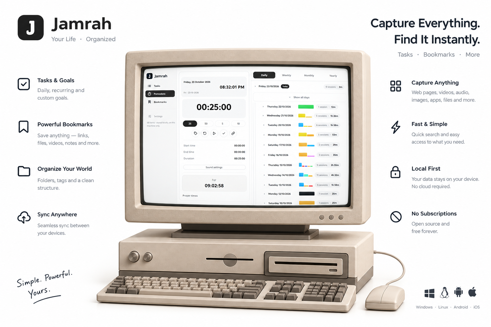
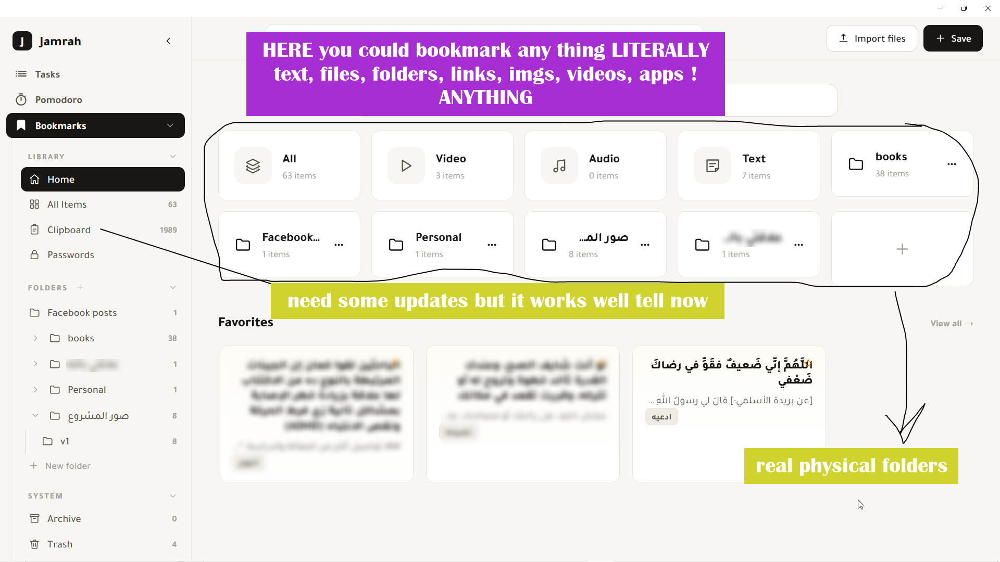
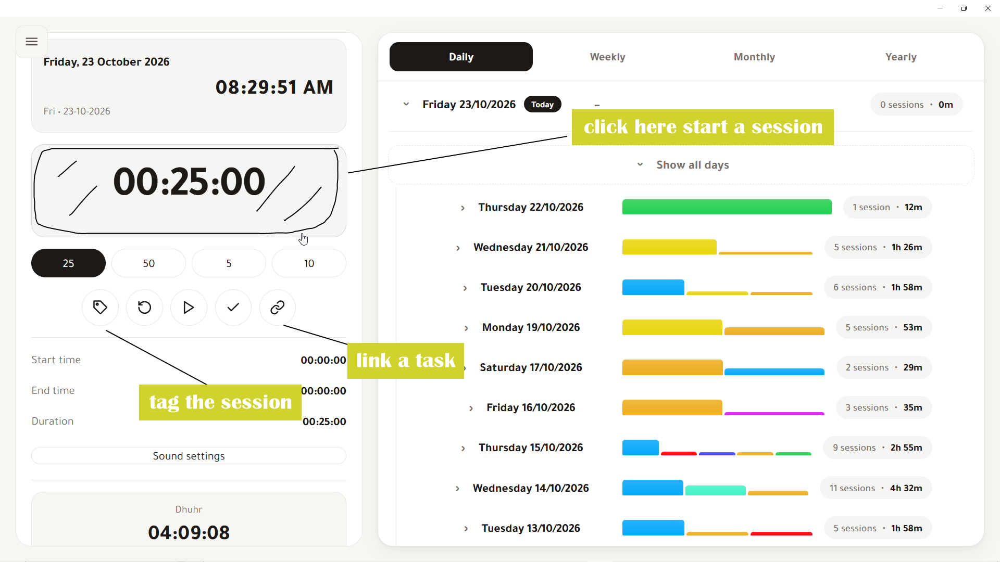
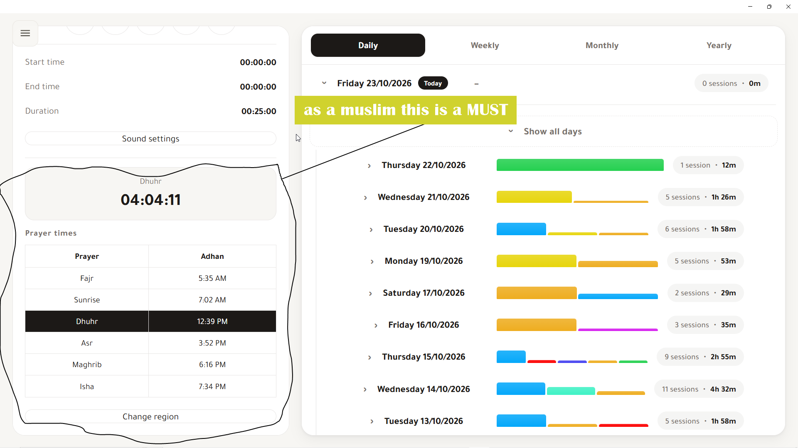
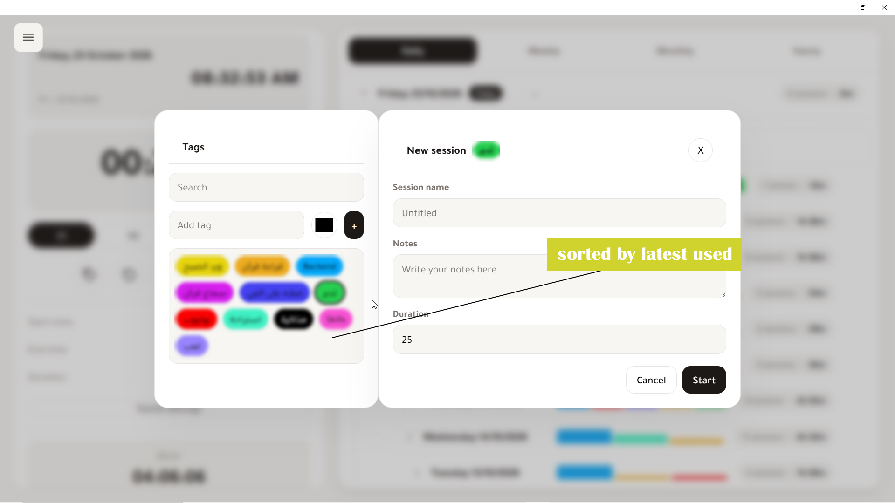
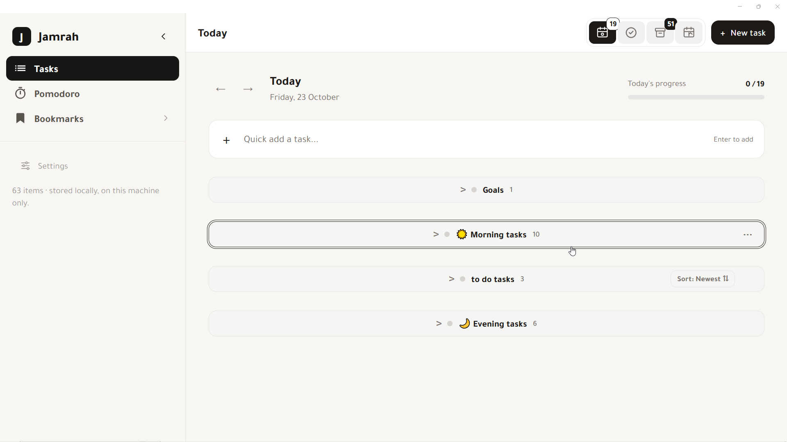

  

<h1 align="center">Jamrah جَــمْــرَه</h1>

<i>Ember of productivity</i>

  

---

Jamrah is a local-first productivity app built with .NET 9 + MAUI (Blazor Hybrid). Everything is stored locally on your machine using SQLite — no accounts, no cloud, no tracking. The UI is RTL Arabic-first with a minimal warm stone design.

> Download the latest version from **[Releases](https://github.com/AhmMed29/jamrah/releases)**.

## Table of Contents

- [Features](#features)
  - [Tasks](#tasks)
  - [Goals](#goals)
  - [Pomodoro / Timer](#pomodoro--timer)
  - [Bookmarks](#bookmarks)
  - [Password](#password)
  - [Settings](#settings)
- [Screenshots](#screenshots)
- [Cross Platform](#cross-platform)
- [Tech Stack](#tech-stack)
- [License](#license)

## Features

### Tasks

- Add morning, to-do, and evening tasks, separated according to your preferences.
- Drag tasks side by side.
- Add sub-tasks.
- Swap two tasks.
- Work with tasks in a way that matches what is in your mind, so you can choose what to do first.

### Goals

- Add recurring goals per day, week, or month, or a one-time goal.
- Track progress toward goals, such as reading 18 of 20 pages.
- Organize goals with tags for upcoming analysis.
- Move between days to see the tasks and goals for that day.
- Add a goal for today only.

### Pomodoro / Timer

- Simple, focused timer design.
- Link a task to a session; the session name stays until you change it.
- Set tags for specific sessions.
- View statistics with tag colors.
- Use full-screen mode for the timer and press Space to start or stop it.
- Customize sounds for Pomodoro actions such as start, stop, and end (experimental).
- Enter your region's latitude and longitude to fetch daily prayer times for the month.
- View sessions by day, week, month, or year, with the time spent in each period.

### Bookmarks

- Save anything at any time from anywhere.
- Save links, images, videos, notes, folders, files (with PDF covers for books), and apps (experimental).
- Use the split view for videos, images, and notes to find what you need faster.
- Open any item in a popup window (some fixes are still needed).
- Add folders and subfolders (experimental, but functional).
- View all items, folders, pinned items, and favorite notes, links, and videos on the Home page.
- ClipAgent runs in the background and saves what you select or copy (experimental).
- Filter by date, tag, type, and more.
- Use right-click and quick actions.
- Archive items before moving them to the trash, and empty the trash after a period before permanent deletion (experimental).
- Access all your tags in one place and manage them (view-only for now).
- The Templates button is intentionally hidden; it was an experimental feature and is no longer used.

### Password

Save passwords with local encryption using a salted password that only you know. Coming in a future update.

### Settings

The Settings page is still a work in progress and will improve in future releases.

## Screenshots

| Bookmarks | Pomodoro |
|---|---|
|  |  |

| Prayer times | Session popup |
|---|---|
|  |  |

## Cross Platform

Jamrah is built with .NET MAUI, which supports multiple platforms. Windows is the only platform released so far.

## Tech Stack

- .NET 9 + MAUI (Blazor Hybrid)
- C# and Razor components
- SQLite via `sqlite-net-pcl`
- Local-first storage with no account or cloud dependency

## License

Copyright (C) 2026 AhmMed29.

Jamrah is free software: you can redistribute it and/or modify it under the terms of the GNU General Public License as published by the Free Software Foundation, **version 3 only**. See [LICENSE](LICENSE) for the full license text.

Previously published releases remain subject to the terms under which they were published.

Third-party assets and dependencies are listed in [THIRD_PARTY_NOTICES.md](THIRD_PARTY_NOTICES.md).
